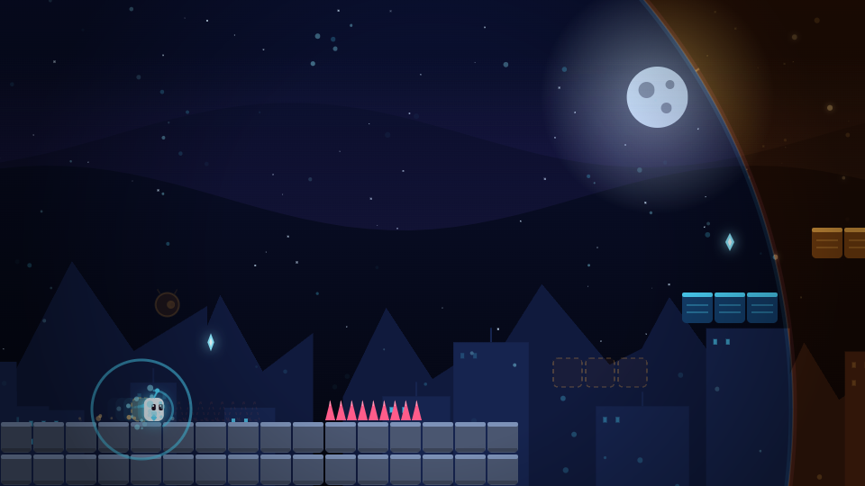
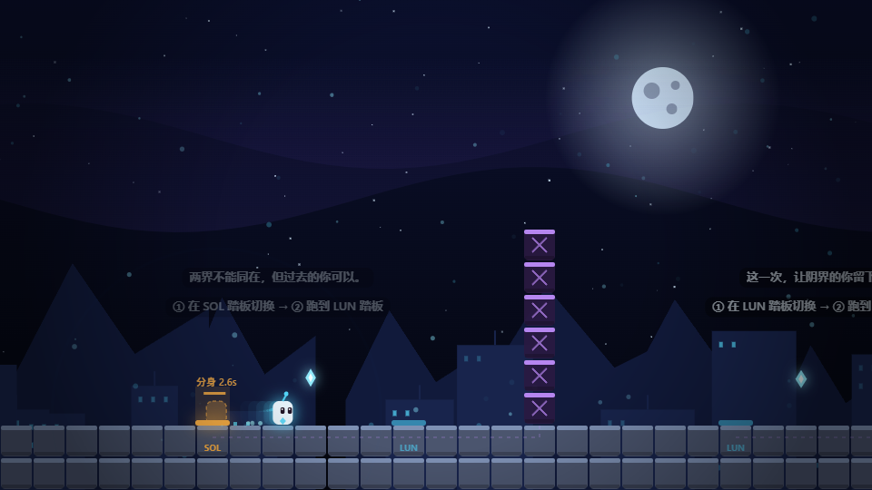

# SHIFT · 双界行者 (Phase Walker)

> Game Off 2026 · Theme: **SHIFT**
> 一个按键，两个世界。此界的断桥，是彼界的通途。

A single-file HTML5 precision platformer about **phase-shifting between two overlapping realities**.
Press `SHIFT` and the world wipes around you: amber daylight (SOL) ↔ cyan moonlight (LUN).
Platforms, spikes and patrol drones exist in only one of the two worlds — the other shows them as
faint dashed ghosts. Read both layers at once, shift at the right moment, and walk out of the overlap.



The browser edition needs no build step or dependencies: open `index.html` and play.

A separate **native Godot 4 project** lives in `godot/project.godot`. Import it into Godot 4.7.2 and
press F6 on `main.tscn` (or F5) to play. This is a GDScript implementation, not an embedded browser.
It includes the same nine levels, double jump and final pressure-plate puzzle, plus Chinese/English
menus and tutorials, gamepad input, native procedural graphics/audio, and separate local progress.
The Windows export preset is included. Godot Web export templates are not installed in the current
environment; the standalone HTML edition remains available for itch.io browser play.

Native controls also include gamepad left stick / D-pad, A to jump, X / shoulder to shift,
Start to pause, and F11 for fullscreen. The pause menu offers Assist and reduced motion.
The native interface has a Meowa-generated day/night station illustration, a separate chapter map,
compact world/status HUD and ticket-style buttons, pause and results. All text and interactive controls
remain native Godot elements, including bilingual labels and keyboard focus. All nine campaign levels remain available
from the original **STATION MAP**; the ten-stop replay journey has its own title entrance and map.
Native saves use Godot's `user://progress.json`; they do not share the browser edition's progress.

### 等我一下 / WAIT FOR ME — ten-stop native journey

Choose **WAIT FOR ME · 10 STOPS** on the native title screen to continue this separate journey,
or use its two-page ten-stop map to replay an unlocked chapter. SHIFT replays your last three seconds of
movement in the world you leave behind. There is one moving double; another SHIFT replaces it.
Walk across a plate, leave the space that becomes solid in the other world, then switch:
your past route can hold the door while you move on.

1. **等我一下 / WAIT FOR ME** — the original three-stage introduction, unchanged.
2. **一个接一个 / ONE AFTER ANOTHER** — record two pauses so one double opens two timed doors in order.
3. **楼上见 / SEE YOU UPSTAIRS** — record a wait upstairs, then fall to the partner plate downstairs.
4. **倒着走试试 / TRY THE OTHER WAY** — travel right-to-left, record blue before amber, then swap worlds between spikes.
5. **中途换班 / YOUR TURN** — alternate day and night doubles; cross each door before handing over.
6. **末班车还没走 / THE LAST TRAIN** — combine ordered doors and raised plates to reach the last train in LUN.
7. **跳过去等我 / JUMP AND WAIT** — record a jump onto a high plate, then return left while your double lands upstairs.
8. **回来接一下我 / COME BACK FOR ME** — backtrack to the partner plate, latch the door, then replace the double and go forward.
9. **一口气过三门 / THREE DOORS, ONE RUN** — record three short pauses and cross three timed doors with one replay.
10. **天亮就到家 / HOME BY SUNRISE** — SHIFT mid-jump between raised day/night stepping stones, then leave the night shift behind and go home in SOL.

Each chapter uses a single jump, three optional shards, checkpoints and its own three-star result.
Live doors have release grace; paired doors latch permanently. `R` retries the latest checkpoint
and counts a retry; after finishing, replay starts the current chapter from its beginning.
Pause freezes recording and playback. The timeline and path preview show what the double will do.
Chapter completion unlocks the next stop, with separate best times and ratings. Existing completion
of the original sample also unlocks stop two; a saved completion of stop six unlocks stop seven.
The original six stops retain their IDs and best records. The original nine campaign levels and HTML edition
retain their existing static-double rules and independent progress.

---

## Play

Open `index.html` in any modern browser, or serve the folder:

```bash
# any static server works
npx serve .
# or
python -m http.server 8000
```

## Controls

| Input | Action |
| --- | --- |
| `← →` / `A D` | Move |
| `Space` / `W` / `↑` | Jump; from level 5, release and press again in midair to double-jump |
| `Shift` | Phase-shift between SOL and LUN |
| `R` | Restart level |
| `Esc` | Pause |
| `M` | Mute |
| Touch | On-screen pads on coarse-pointer devices |

## The loop

- **9 hand-built levels** with a rising difficulty curve, checkpoints, collectible phase shards and star ratings
  (clear · all shards · no deaths).
- **Double jump unlocks in level 5, 再跳一下 (One More Jump)**: release and press jump again for one
  extra midair boost. Landing restores it; switching worlds does not. A filled dot beneath the airborne
  player means the boost is ready, and an outline means it is spent. Touch uses the same release-and-tap rule.
  The first four levels keep single-jump controls; later levels combine the boost with world switching.
- **帮我踩一下 (Hold This for Me)**: in the final puzzle, SHIFT leaves a three-second double in the previous world.
  Leave it on a SOL pressure plate, then reach its LUN partner before it fades. Both plates must be
  pressed together to permanently unlock the resonance gate. The second gate reverses the roles.
  There is only one echo at a time; shifting again replaces it. Pause freezes its countdown.
- **Shift is a resource, not a spammable button**: a short cooldown ring orbits the player, and shifting into
  solid matter is *denied* with a red pulse — you must read the ghost layer first.
- **Dual-world hazards**: spikes and patrol drones are real in one world, ghosted in the other.
- **Best time + new-record tracking**, per-level stars and unlock progression, saved locally.
- **休闲 / Assist mode** (pause menu): slower drones and forgiving spike hitboxes, persisted across sessions.

## Feel & craft

- Fixed-timestep simulation (60 Hz) with accumulator, axis-separated AABB tile collision.
- Platformer juice: coyote time, jump buffering, jump-cut, apex float, squash & stretch, landing dust,
  motion trail, speed streaks, a trailing scarf, idle breathing, screen shake (trauma²), hit-stop.
- **Radial phase-wipe**: on shift, both worlds are rendered to offscreen canvases and the new reality is
  revealed through an expanding chromatic-ringed circle centred on the player.
- Living backgrounds: parallax silhouettes, twinkling stars, aurora bands, sun/moon with rays & craters,
  rising SOL embers / falling LUN spores, occasional LUN meteors.
- **Fully synthesized audio** (WebAudio, zero assets): a generative dual chord-progression score that
  crossfades with the world, plus jump / land / shard / shift / deny / death / win cues.
- Phase echoes: a dashed afterimage of your previous-world self lingers for a beat after each shift.
- Shard combo chains with escalating pitch and on-screen `×N 相位连锁` popups.
- `prefers-reduced-motion` respected (shake / wipe / particle counts reduced).

## Tech

- Vanilla JS + Canvas 2D + WebAudio + DOM HUD. **Zero dependencies, zero external assets.**
- DPR-capped rendering (≤2×) with offscreen compositing for the wipe.
- localStorage persistence (`shift_save_v1`, `shift_assist`, `shift_muted`).

## 帮我踩一下 / Hold This for Me



Two worlds cannot coexist. Your past self can.

## Test

Node.js 18+ is needed only for the regression suite, not for playing:

```bash
node --test test.mjs
```

The suite checks maps, spawn safety, keyboard-only clears of levels 1 and 5–9 (including all four
level-5 platforms and all shards/checkpoints in levels 6–8), double-jump unlock/reset/input limits,
echo expiry and world/ground contact, gate collisions, pause/restart/death, shift denial, assist physics,
and timing.
Rendering uses lightweight stubs in these unit tests; browser visual checks are separate.

For the native edition, run the Godot executable with:

```bash
godot --headless --path godot --script res://tests/regression.gd
godot --headless --path godot --script res://tests/sample_regression.gd
godot --path godot -- --smoke-test
godot --path godot -- --sample-smoke
godot --path godot --script res://tests/sample_regression.gd -- --sample-tour
godot --path godot --script res://tests/ui_regression.gd
```

The headless suites check all nine campaign routes and all ten replay chapters' full-collection
routes in normal and Assist/reduced-motion modes, recording/replay, plate support, door safety,
pause, checkpoint retry and independent results. The windowed smoke tests exercise real key events,
chapter-map navigation and bilingual menus. The sample tour renders the new puzzles and endings.
Captures go into `godot/build/`. Tests do not write player progress; create the local build
directory before capturing. Native window tests do not claim physical gamepad or Web-export testing.

## Package and publish

On Windows, run `./package.ps1` in PowerShell to create a timestamped HTML5 ZIP with `index.html`
at the archive root. It runs the tests first and excludes Git metadata, publishing scripts and screenshots.

To create a **new public GitHub repository**, install the official GitHub CLI, then run:

```powershell
gh auth login
.\publish-github.ps1
```

The script pushes the existing local commit using your authenticated account. It stops if an origin
remote already exists, if the working tree is dirty, or if creation fails; it never force-pushes.
It does not store tokens in project files. Review the files and commit before running it.

For itch.io, see `itch-submission.txt`: upload the HTML5 ZIP, publish the game page, then submit that
published game to Game Off 2026 separately. Publishing a game page alone is not jam submission.
No upload or jam submission has been performed by these local packaging scripts.

## Credits and license

Created by Alaneve541 with Qoder AI assistance in programming, level iteration and testing.
Browser graphics are drawn procedurally in Canvas; browser music and sound effects use WebAudio.
The native edition uses Godot drawing APIs and generated PCM audio, with Chinese/English UI.
Its menu artwork (`godot/assets/ui/meowa-station.png`) was generated in Meowa on 2026-11-22
using the UI asset workflow and the site's GPT Image 2.6 (new) option, at 2048×1536. It is bundled
locally, cropped at runtime and does not require Meowa login or network access to play. Gameplay
art and all audio remain procedural. Native text uses the player's installed system fonts;
no Windows font files are redistributed. Windows packages include Godot's engine and dependency
license notices alongside this project's MIT license.

MIT — see [LICENSE](LICENSE). Made for Game Off 2026.